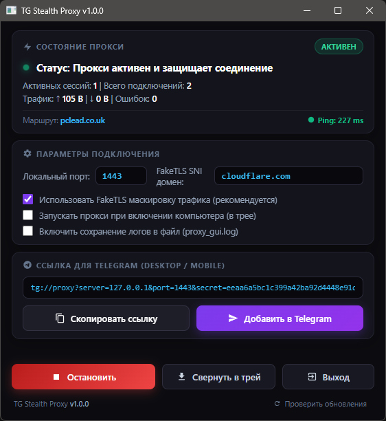
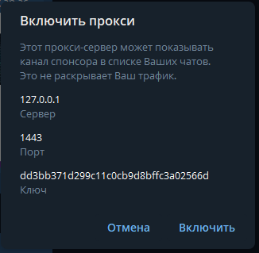
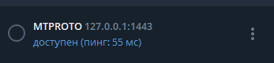

# ⚡ TG Stealth Proxy (v1.0.0)

<p align="center">
  
</p>

<p align="center">
  <strong>Высокопроизводительный MTProto & WebSocket стелс-прокси для Telegram с современным графическим интерфейсом для Windows</strong>
</p>

<p align="center">
  
  
  
  
  
</p>

---

## 🌟 Обзор проекта

**TG Stealth Proxy** — это высокоскоростной стелс-прокси для Telegram, написанный на **Rust** в виде автономного нативного десктопного приложения для Windows.

Приложение маскирует трафик Telegram под обычный HTTPS/WSS-трафик к Cloudflare Anycast CDN, обходя блокировки ТСПУ и DPI операторов связи, и упаковано в стильный темный интерфейс (Glassmorphism) с системным треем, автозагрузкой и нулевым потреблением ресурсов.

---

## 📸 Скриншоты интерфейса

### Главное окно приложения

<p align="center">
  
</p>

### Интеграция с Telegram Desktop

<p align="center">
  
  &nbsp;&nbsp;&nbsp;&nbsp;
  
</p>

---

## 🚀 Ключевые возможности

### 🎨 Современный GUI (Dark Glassmorphism)
- **Управление в один клик:** Быстрый запуск и остановка сервиса кнопкой в шапке.
- **Подключение к Telegram в 1 клик:** Кнопка **«Открыть в Telegram»** мгновенно передает параметры прокси в Telegram Desktop через протокол `tg://proxy`.
- **Живая аналитика и RTT:** Мониторинг в реальном времени:
  - 👥 Активные сессии
  - ⚡ Всего соединений
  - 📊 Прокачанный трафик (отдача/прием)
  - 📶 **Ping (задержка до Cloudflare)** в реальном времени
  - 🌐 Текущий активный Anycast-маршрут
- **Анимированные Toast-уведомления:** Мгновенный отклик при копировании ссылок и изменении параметров.
- **Проверка обновлений:** Кнопка проверки свежих релизов на GitHub прямо в интерфейсе.

### 🛡️ Продвинутое сетевое ядро (Rust + Tokio)
- **Стелс-маскировка FakeTLS & MTProto:** Поддержка всех режимов рукопожатия (`0xEF`, `0xEE`, `0xDD`), случайное заполнение TLS-записей для защиты от DPI и активного зондирования.
- **Latency Probing (Автозамер пинга):** Конкурентное тестирование пула доменов Cloudflare и автоматическая сортировка по минимальной задержке (RTT).
- **DC Balancer с привязкой доменов (Domain Affinity):** Запоминание проверенного домена для каждого датацентра Telegram (`DC1..DC5`), исключающее лишние TLS-рукопожатия.
- **Пул соединений (WsPool & CfWorkerPool):** Предварительно прогретые WebSocket-соединения для мгновенной доставки сообщений без задержки на первичное подключение.
- **WebSocket-маршрутизация v1.11.2:** Оптимизированная маршрутизация не-медиа трафика исключительно через управляющие эндпоинты `kws{dc}.web.telegram.org`.
- **Автообновление и деобфускация доменов:** Автоматическая синхронизация списка Cloudflare Anycast доменов с дешифровкой шифра Цезаря и локальным кэшированием в `cf_domains.cache`.

### 🖥️ Глубокая интеграция с Windows
- **Системный трей:** Сворачивание приложения в область уведомлений. Иконка динамически меняет цвет:
  - 🟢 **Зеленая** — прокси запущен и защищает соединение;
  - ⚫ **Темная** — прокси остановлен.
- **Автозагрузка:** Чекбокс в окне настроек регистрирует запуск при старте Windows (`HKCU\Software\Microsoft\Windows\CurrentVersion\Run`) с ключом `--minimized` (запуск скрытно сразу в трей).
- **Поддержка спящего режима (`WM_POWERBROADCAST`):** При уходе в сон и пробуждении ПК устаревшие сокеты пула автоматически обновляются, исключая зависания при первом открытии Telegram.
- **Чистое завершение (Job Objects):** Интеграция с Windows Job Objects гарантирует мгновенное уничтожение всех дочерних потоков при выходе из программы — никаких «зависших» процессов в Диспетчере задач.
- **Сохранение настроек:** Настройки порта, SNI-домена, FakeTLS и логгирования сохраняются в `config.json` рядом с программой.

---

## 📥 Установка и запуск

### Вариант 1. Готовый бинарник (Рекомендуется)
1. Перейдите в раздел [**Releases**](https://github.com) и скачайте `tg-stealth-proxy.exe`.
2. Распакуйте в любую удобную папку.
3. Запустите `tg-stealth-proxy.exe`.
4. Нажмите кнопку **«+ Добавить в Telegram»** и подтвердите добавление в Telegram Desktop.

### Вариант 2. Сборка из исходников
Для сборки потребуется установленный [Rust Toolchain (rustup)](https://rustup.rs/):

```bash
# Клонируйте репозиторий
git clone https://github.com/your-username/tg-stealth-proxy.git
cd tg-stealth-proxy

# Соберите оптимизированный релиз
cargo build --release

# Исполняемый файл будет доступен в папке target/release/:
target\release\tg-stealth-proxy.exe
```

Или воспользуйтесь скриптом быстрого запуска:
```cmd
start_gui.bat
```

---

## ⚙️ Конфигурация (`config.json`)

При первом запуске рядом с `.exe` создается файл `config.json`:

```json
{
  "port": 1443,
  "sni": "cloudflare.com",
  "use_fake_tls": true,
  "logging": false
}
```

- **`port`** — локальный порт для входящих подключений от Telegram (по умолчанию `1443`).
- **`sni`** — домен для FakeTLS SNI маскировки (по умолчанию `cloudflare.com`).
- **`use_fake_tls`** — включение режима FakeTLS с TLS-записями.
- **`logging`** — запись отладочных логов в файл `proxy_gui.log` (по умолчанию выключено для экономии ресурсов диска).

---

## 🛠️ Стек технологий

- **Ядро:** [Rust](https://www.rust-lang.org/) + [Tokio](https://tokio.rs/)
- **Веб-сокеты и TLS:** `tokio-tungstenite`, `tokio-native-tls` (`schannel`), `aes`, `ctr`, `sha2`, `hmac`
- **GUI Engine:** [Wry](https://github.com/tauri-apps/wry) + [Tao](https://github.com/tauri-apps/tao) (Microsoft WebView2)
- **Windows API:** `windows-sys` (Win32 Shell, GDI, Job Objects, Subclassing, Registry)

---

## 📄 Лицензия

Распространяется под лицензией **MIT**. Подробности в файле [LICENSE](LICENSE).

---

## 🙏 Благодарности
- Проекту [Flowseal/tg-ws-proxy](https://github.com/Flowseal/tg-ws-proxy) за оригинальную идею и алгоритмы обхода блокировок через Cloudflare WebSocket.
